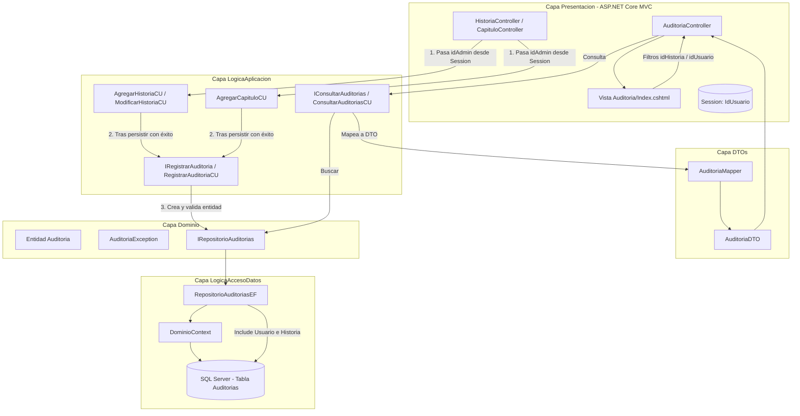

# Explicación de la Implementación: RF05 – Auditoría de Historias

Este documento detalla la arquitectura, el diseño y la implementación completa del requerimiento **RF05 – Auditoría de historias** en el sistema de Historias Interactivas, desarrollado bajo el enfoque de **Domain-Driven Design (DDD)** en ASP.NET Core (.NET 10).

---

## 1. Requerimiento: RF05 – Auditoría de Historias

> **RF05 – Auditoría de historias – AUTOMÁTICO SISTEMA / Rol Administrador**  
> *Las acciones de creación, edición y publicación de historias y capítulos deberán ser auditables: el sistema registrará la acción realizada, la fecha y el usuario administrador que la realizó. Un administrador podrá consultar esta información filtrando por historia o por administrador.*

### Objetivos Principales:
1. **Registro Automático**: El sistema debe auditar las mutaciones críticas (creación de historia, edición de historia, publicación de historia y creación de capítulos) de forma automática y transparente, sin que el usuario deba realizar ninguna acción manual adicional.
2. **Inmutabilidad y Trazabilidad**: Cada registro de auditoría almacena la fecha/hora exacta del suceso, la acción semántica efectuada, el administrador responsable y la historia sobre la que impactó. Los registros de auditoría no pueden ser modificados ni eliminados.
3. **Consulta con Filtros (Exclusivo Administrador)**: Una pantalla de gestión accesible únicamente con rol `Administrador`, que permite consultar el historial completo y aplicar filtros combinables por **Historia** y/o por **Usuario Administrador**.

---

## 2. Diagrama de Arquitectura y Flujo



---

## 3. Desglose Detallado por Capas

### 3.1. Capa Dominio (`ProyectoObligatorio`)
* **Entidad `Auditoria` (`Dominio.Entidades.Auditoria`)**:
  * `int Id`: Clave primaria autonumérica.
  * `DateTime Fecha`: Fecha y hora en la que se produjo la acción.
  * `string Accion`: Descripción textual de la operación realizada.
  * `int? idUsuario` y `Usuario? Usuario`: Clave foránea y navegación al administrador responsable.
  * `int? idHistoria` y `Historia? Historia`: Clave foránea y navegación a la historia involucrada.
  * **Reglas de Dominio (`Validar()`)**:
    * La acción no puede ser nula ni vacía.
    * La fecha no puede ser la predeterminada (`default`).
    * Es obligatorio asociar tanto el usuario administrador como la historia.
* **Excepción `AuditoriaException` (`Dominio.Excepciones.AuditoriaException`)**:
  * Excepción de contexto que aísla los errores de auditoría del resto de los dominios (siguiendo el patrón `HistoriaException`, `CapituloException`, etc.).
* **Interfaz `IRepositorioAuditorias` (`Dominio.InterfaceDeRepositorio.IRepositorioAuditorias`)**:
  * Extiende del contrato genérico `IRepository<Auditoria>`.
  * Añade la firma especializada de consulta con filtros opcionales:
    ```csharp
    List<Auditoria> Buscar(int? idHistoria, int? idUsuario);
    ```

---

### 3.2. Capa Acceso a Datos (`LogicaAccesoDatos`)
* **Contexto de EF Core (`DominioContext.cs`)**:
  * Se agregó el `DbSet<Auditoria> Auditorias { get; set; }`.
  * En `OnModelCreating`, se configuraron las relaciones foráneas:
    ```csharp
    modelBuilder.Entity<Auditoria>()
        .HasOne(a => a.Usuario)
        .WithMany()
        .HasForeignKey(a => a.idUsuario)
        .OnDelete(DeleteBehavior.Restrict);

    modelBuilder.Entity<Auditoria>()
        .HasOne(a => a.Historia)
        .WithMany()
        .HasForeignKey(a => a.idHistoria)
        .OnDelete(DeleteBehavior.Restrict);
    ```
    * **Decisión de Diseño**: Se utiliza `DeleteBehavior.Restrict` para evitar borrados en cascada que destruirían la pista de auditoría y prevenir errores de múltiples rutas en cascada en SQL Server.
* **Repositorio EF (`RepositorioAuditoriasEF.cs`)**:
  * **`Add(Auditoria nuevo)`**: Valida la entidad en el dominio y la inserta en la base de datos.
  * **`Buscar(int? idHistoria, int? idUsuario)`**: Devuelve la lista filtrada con una cadena única sobre el `DbSet`: `.Include(a => a.Usuario)` e `.Include(a => a.Historia)` para traer las relaciones, un `.Where(...)` con los filtros de historia y usuario solo si vienen con valor mayor a cero (si vienen `null` o `<= 0` no filtran), y `.OrderByDescending(a => a.Fecha)` para ordenar de forma cronológica descendente. El resultado se materializa con `.ToList()`.
  * **Inmutabilidad**: Los métodos `Update` y `Remove` lanzan `NotSupportedException` para garantizar que nadie pueda alterar ni eliminar registros de auditoría existentes.
* **Migración de Base de Datos**:
  * Se generó y aplicó la migración `20261015180900_AgregacionAuditoria`, creando la tabla `Auditorias` con índices en `idHistoria` e `idUsuario`.

---

### 3.3. Capa DTOs (`DTOs`)
* **`AuditoriaDTO` (`DTOs.DTOs.AuditoriaDTO`)**:
  * Objeto plano desacoplado del dominio:
    ```csharp
    public class AuditoriaDTO
    {
        public int Id { get; set; }
        public DateTime Fecha { get; set; }
        public string Accion { get; set; }
        public int? IdUsuario { get; set; }
        public string? NombreUsuario { get; set; }
        public int? IdHistoria { get; set; }
        public string? TituloHistoria { get; set; }
    }
    ```
* **`AuditoriaMapper` (`DTOs.Mappers.AuditoriaMapper`)**:
  * Métodos puros estáticos `ToDTO` y `FromDTO` para transferir información sin exponer entidades de dominio a la vista.

---

### 3.4. Capa Lógica de Aplicación (`LogicaAplicacion`)
* **`IRegistrarAuditoria` / `RegistrarAuditoriaCU`**:
  * Caso de uso dedicado para encapsular el alta de registros de auditoría:
    ```csharp
    public void Ejecutar(string accion, int idHistoria, int idUsuarioAdmin)
    {
        Auditoria nuevaAuditoria = new Auditoria
        {
            Fecha = DateTime.Now,
            Accion = accion,
            idHistoria = idHistoria,
            idUsuario = idUsuarioAdmin
        };
        _repoAuditorias.Add(nuevaAuditoria);
    }
    ```
* **`IConsultarAuditorias` / `ConsultarAuditoriasCU`**:
  * Orquesta la búsqueda filtrada invocando `Buscar(idHistoria, idUsuario)` del repositorio y mapeando los resultados a `List<AuditoriaDTO>`.
* **Instrumentación Automática en Casos de Uso Existentes**:
  1. **`AgregarHistoriaCU`**: Tras llamar a `repositorioHistorias.Add(historiaCreada)`, dispara automáticamente:
     ```csharp
     _registrarAuditoria.Ejecutar("Creación de Historia", historiaCreada.Id, idUsuarioAdmin.Value);
     ```
  2. **`ModificarHistoriaCU`**: Tras llamar a `repositorioHistorias.Update(...)`, detecta si el estado cambió a `Publicada` para registrar `"Publicación de Historia"`, o de lo contrario `"Modificación de Historia"`.
  3. **`AgregarCapituloCU`**: Tras persistir el nuevo capítulo y actualizar el antecedente con la opción respectiva, dispara:
     ```csharp
     _registrarAuditoria.Ejecutar($"Creación de Capítulo: {nuevoCapitulo.Titulo.Valor}", historia.Id, idUsuarioAdmin.Value);
     ```

---

### 3.5. Capa Presentación (`Presentacion` - MVC)
* **Captura de la Sesión de Administrador**:
  * Los controladores [`HistoriaController`](file:///E:/CODIGO/Repos/ObligatorioDW/Presentacion/Controllers/HistoriaController.cs) y [`CapituloController`](file:///E:/CODIGO/Repos/ObligatorioDW/Presentacion/Controllers/CapituloController.cs) extraen el ID del administrador autenticado desde la sesión (`HttpContext.Session.GetInt32("IdUsuario")`) y lo envían como parámetro al caso de uso correspondiente.
* **`AuditoriaController` (`Presentacion.Controllers.AuditoriaController`)**:
  * **Seguridad**: Valida en el `GET` que `Session.GetString("Rol") == "Administrador"`. Si no lo es, redirige al Login.
  * **Acción `Index(int? idHistoria, int? idUsuario)`**:
    * Ejecuta `_consultarAuditoriasCU.Ejecutar(idHistoria, idUsuario)`.
    * Carga las historias para el desplegable mediante `_encontrarTodasHistoriasCU.Ejecutar()`.
    * Carga los administradores para el desplegable filtrando aquellos usuarios con `Rol == Administrador`.
    * Retorna la vista pasando `auditorias` directamente como `@model IEnumerable<AuditoriaDTO>`.
* **Vista `Auditoria/Index.cshtml` (`Presentacion/Views/Auditoria/Index.cshtml`)**:
  * **Filtros combinables**: Formulario con método `GET` con dos selectores (`idHistoria` e `idUsuario`) y botones "Filtrar" y "Limpiar".
  * **Tabla de Resultados**: Muestra columnas con formato amigable:
    * **Fecha y Hora**: `dd/MM/yyyy HH:mm:ss`.
    * **Administrador**: Nombre de usuario e ID entre paréntesis.
    * **Acción**: Etiqueta (badge) visual destacando la acción realizada.
    * **Historia Afectada**: Título de la historia e ID entre paréntesis.
* **Barra de Navegación (`_Layout.cshtml`)**:
  * Se agregó el botón **"Auditoría"** en el navbar, visible únicamente cuando `Context.Session.GetString("Rol") == "Administrador"`.

---

## 4. Inyección de Dependencias

Se registraron los contratos en el contenedor de dependencias tanto en `Presentacion/Program.cs` como en `WebApi/Program.cs`:
```csharp
// Repositorios
builder.Services.AddScoped<IRepositorioAuditorias, RepositorioAuditoriasEF>();

// Casos de Uso
builder.Services.AddScoped<IRegistrarAuditoria, RegistrarAuditoriaCU>();
builder.Services.AddScoped<IConsultarAuditorias, ConsultarAuditoriasCU>();
```

---

## 5. Decisiones de Diseño y Restricciones Cumplidas

1. **Sin ViewModels**:
   * La vista de consulta utiliza directamente `@model IEnumerable<DTOs.DTOs.AuditoriaDTO>`.
   * Los filtros desplegables viajan como colecciones auxiliares `SelectList` mediante `ViewBag` (mismo patrón que usa `HistoriaController` para sus categorías).
2. **Sin variables `var`**:
   * Todas las variables en todas las capas (`Auditoria`, repositorios, casos de uso, controladores y vistas Razor) cuentan con su tipo explícito.
3. **Persistencia Inmutable**:
   * Las auditorías solo se insertan (`Add`) y consultan (`Buscar`/`FindAll`). No existe interfaz ni método para alterarlas ni borrarlas.
4. **Desacoplamiento Web/Dominio**:
   * El caso de uso no lee de `HttpContext.Session`; recibe el `idUsuarioAdmin` como parámetro. Esto permite que el mismo caso de uso sea llamado desde la API REST (`WebApi`), desde tests automatizados o desde procesos batch sin acoplarse al contexto HTTP.
