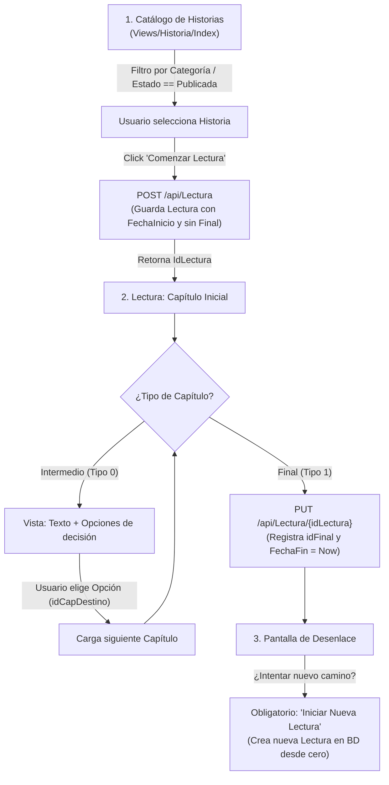

# Plan de Implementación: RF07 – Lectura de historia – Rol Usuario

## 1. Descripción del Requerimiento
> **RF07 – Lectura de historia – Rol Usuario**:
> El sistema mostrará el listado de historias publicadas (filtrable por categoría). El usuario selecciona una, comienza la lectura desde el capítulo inicial y, en cada capítulo intermedio, elige una opción para avanzar, hasta llegar a un final. El sistema debe registrar el final alcanzado cuando esto ocurra. Una vez alcanzado un posible final de la historia, para intentar un nuevo camino deberá iniciar una nueva lectura.

---

## 2. Arquitectura del Sistema
El proyecto sigue una arquitectura DDD y multicapa dividida en:
- **Backend**:
  - `Dominio`: Entidades (`Historia`, `Capitulo`, `Intermedio`, `Final`, `Opcion`, `Lectura`), Value Objects y Excepciones.
  - `DTOs`: Mappers y objetos de transferencia planos (`HistoriaDTO`, `CapituloDTO`, `LecturaDTO`).
  - `LogicaAccesoDatos`: Contexto EF Core (`DominioContext`) y repositorios (`RepositorioLecturasEF`, `RepositorioHistoriasEF`, `RepositorioFinalesEF`).
  - `LogicaAplicacion`: Casos de uso (`AgregarLecturaCU`, `ActualizarLecturaCU`, `ObtenerHistoriaPorIdCU`, etc.).
  - `WebApi`: API REST (`ApiWeb`) que expone los endpoints protegidos o públicos para lectura y catálogo.
- **Frontend Lector**:
  - `ProyectoSecundario`: Aplicación ASP.NET Core MVC para el rol `Usuario` que consume la `WebApi` vía cliente HTTP (`ClienteHttpAuxiliar`).
  - *(Nota: `Presentacion` es la aplicación MVC del Administrador para el backoffice).*

---

## 3. Diagrama de Flujo



---

## 4. Componentes y Código a Implementar

### A. Capa Backend (`LogicaAplicacion` y `WebApi`)

#### 1. Caso de Uso `AgregarLecturaCU` (`LogicaAplicacion/CasosDeUso/Lecturas/AgregarLecturaCU.cs`)
- **Responsabilidad**: Registrar el inicio de una lectura validando las reglas de dominio.
- **Reglas**:
  - Validar que la historia esté en `EstadoHistoria.Publicada`.
  - Asociar `Usuario` e `Historia` trackeados desde sus repositorios (evitando grafos duplicados en EF Core).
  - Asignar `FechaInicio = DateTime.Now`, `FechaFin = null`, `FinalAlcanzado = null`.
  - Retornar el `Id` de la lectura creada para que el cliente pueda rastrearla.

```csharp
public class AgregarLecturaCU : IAgregarLectura
{
    private readonly IRepositorioLecturas _repoLecturas;
    private readonly IRepositorioHistorias _repoHistorias;
    private readonly IRepositorioUsuarios _repoUsuarios;

    public AgregarLecturaCU(
        IRepositorioLecturas repoLecturas,
        IRepositorioHistorias repoHistorias,
        IRepositorioUsuarios repoUsuarios)
    {
        _repoLecturas = repoLecturas;
        _repoHistorias = repoHistorias;
        _repoUsuarios = repoUsuarios;
    }

    public int Ejecutar(LecturaDTO dto)
    {
        if (dto == null) throw new LecturaException("Los datos de lectura son requeridos.");
        if (!dto.idHistoria.HasValue || !dto.idUsuario.HasValue)
            throw new LecturaException("Historia y Usuario son obligatorios para iniciar una lectura.");

        Historia historia = _repoHistorias.FindById(dto.idHistoria.Value);
        if (historia.Estado != EstadoHistoria.Publicada)
            throw new LecturaException("Solo se pueden leer historias que estén publicadas.");

        Usuario usuario = _repoUsuarios.FindById(dto.idUsuario.Value);

        Lectura nueva = new Lectura
        {
            Usuario = usuario,
            idUsuario = usuario.Id,
            Historia = historia,
            idHistoria = historia.Id,
            FechaInicio = DateTime.Now,
            FechaFin = null,
            FinalAlcanzado = null,
            idFinal = null
        };

        _repoLecturas.Add(nueva);
        return nueva.Id;
    }
}
```

#### 2. Caso de Uso `ActualizarLecturaCU` (`LogicaAplicacion/CasosDeUso/Lecturas/ActualizarLecturaCU.cs`)
- **Estado**: Ya existente en el proyecto.
- **Acción**: Valida que la lectura exista, invoca `existente.ValidarModificacion()` (inmutable si ya terminó), comprueba que el capítulo final exista y pertenezca a la misma historia, y actualiza `idFinal` y `FechaFin`.
- *(Mejora opcional)*: Si se desea contabilizar la estadística de llegadas al final, incrementar el valor de `CantLlegaron` en la entidad `Final`.

#### 3. Controlador `LecturaController` (`WebApi/Controllers/LecturaController.cs`)
- Ajustar `POST /api/Lectura` para que devuelva el identificador generado:
```csharp
[HttpPost]
[ProducesResponseType((int)HttpStatusCode.Created)]
[ProducesResponseType((int)HttpStatusCode.BadRequest)]
public ActionResult Post([FromBody] LecturaDTO dto)
{
    try
    {
        int nuevoId = _agregarLecturaCu.Ejecutar(dto);
        dto.Id = nuevoId;
        return CreatedAtAction(nameof(Get), new { id = nuevoId }, dto);
    }
    catch (LecturaException lex)
    {
        return BadRequest(lex.Message);
    }
    catch (Exception ex)
    {
        return StatusCode(500, ex.Message);
    }
}
```

---

### B. Capa Frontend Lector (`ProyectoSecundario`)

#### 1. ViewModel para Lectura en Progreso (`ProyectoSecundario/Models/LecturaProgresoViewModel.cs`)
```csharp
namespace ProyectoSecundario.Models
{
    public class LecturaProgresoViewModel
    {
        public int LecturaId { get; set; }
        public int HistoriaId { get; set; }
        public string TituloHistoria { get; set; } = string.Empty;
        public CapituloModel CapituloActual { get; set; } = new CapituloModel();
        public bool EsFinal => CapituloActual.Tipo == 1; // 0: Intermedio, 1: Final
    }
}
```

#### 2. Catálogo de Historias (`ProyectoSecundario/Controllers/HistoriaController.cs`)
```csharp
public class HistoriaController : Controller
{
    private readonly string _baseUrlHistoria = "http://localhost:5281/api/Historia";
    private readonly string _baseUrlCategoria = "http://localhost:5281/api/Categoria";

    public IActionResult Index(int? idCategoria)
    {
        string token = HttpContext.Session.GetString("token");
        if (string.IsNullOrEmpty(token)) return RedirectToAction("Login", "Auth");

        // 1. Obtener categorias para el filtro
        var respCat = ClienteHttpAuxiliar.EnviarSolicitud(_baseUrlCategoria, VerbosHttp.GET, token: token);
        List<CategoriaModel> categorias = new();
        if (respCat.IsSuccessStatusCode)
        {
            categorias = JsonConvert.DeserializeObject<List<CategoriaModel>>(ClienteHttpAuxiliar.ObtenerBody(respCat)) ?? new();
        }

        // 2. Obtener historias y filtrar publicadas (Estado == 1)
        var respHist = ClienteHttpAuxiliar.EnviarSolicitud(_baseUrlHistoria, VerbosHttp.GET, token: token);
        List<HistoriaModel> historias = new();
        if (respHist.IsSuccessStatusCode)
        {
            var todas = JsonConvert.DeserializeObject<List<HistoriaModel>>(ClienteHttpAuxiliar.ObtenerBody(respHist)) ?? new();
            historias = todas.Where(h => h.Estado == 1).ToList();

            if (idCategoria.HasValue && idCategoria.Value > 0)
            {
                historias = historias.Where(h => h.Categorias != null && h.Categorias.Any(c => c.Id == idCategoria.Value)).ToList();
            }
        }

        ViewBag.Categorias = categorias;
        ViewBag.CategoriaSeleccionada = idCategoria;
        return View(historias);
    }
}
```

#### 3. Navegación y Finalización (`ProyectoSecundario/Controllers/LecturaController.cs`)
```csharp
public class LecturaController : Controller
{
    private readonly string _baseUrlLectura = "http://localhost:5281/api/Lectura";
    private readonly string _baseUrlHistoria = "http://localhost:5281/api/Historia";

    // Inicia una nueva lectura y redirige al capitulo inicial
    [HttpPost]
    public IActionResult Comenzar(int idHistoria)
    {
        string token = HttpContext.Session.GetString("token");
        int? idUsuario = HttpContext.Session.GetInt32("idUsuario"); // o parseado de TokenModel

        var model = new LecturaModel
        {
            idHistoria = idHistoria,
            idUsuario = idUsuario,
            FechaInicio = DateTime.Now
        };

        var respuesta = ClienteHttpAuxiliar.EnviarSolicitud(_baseUrlLectura, VerbosHttp.POST, model, token);
        if (!respuesta.IsSuccessStatusCode)
        {
            TempData["Error"] = "No se pudo iniciar la lectura.";
            return RedirectToAction("Index", "Historia");
        }

        var lecturaCreada = JsonConvert.DeserializeObject<LecturaModel>(ClienteHttpAuxiliar.ObtenerBody(respuesta));

        // Obtener capitulo inicial de la historia
        var respHist = ClienteHttpAuxiliar.EnviarSolicitud($"{_baseUrlHistoria}/{idHistoria}", VerbosHttp.GET, token: token);
        var historia = JsonConvert.DeserializeObject<HistoriaModel>(ClienteHttpAuxiliar.ObtenerBody(respHist));

        return RedirectToAction("Leer", new {
            idLectura = lecturaCreada.Id,
            idHistoria = idHistoria,
            idCapitulo = historia.idCapituloInicial
        });
    }

    // Muestra el capitulo actual y si es final registra el desenlace
    [HttpGet]
    public IActionResult Leer(int idLectura, int idHistoria, int idCapitulo)
    {
        string token = HttpContext.Session.GetString("token");

        var respHist = ClienteHttpAuxiliar.EnviarSolicitud($"{_baseUrlHistoria}/{idHistoria}", VerbosHttp.GET, token: token);
        var historia = JsonConvert.DeserializeObject<HistoriaModel>(ClienteHttpAuxiliar.ObtenerBody(respHist));

        var capituloActual = historia.Capitulos.FirstOrDefault(c => c.Id == idCapitulo);
        if (capituloActual == null) return NotFound("Capítulo no encontrado en la historia.");

        var vm = new LecturaProgresoViewModel
        {
            LecturaId = idLectura,
            HistoriaId = idHistoria,
            TituloHistoria = historia.Titulo,
            CapituloActual = capituloActual
        };

        // Si es capitulo final, registramos en la API
        if (vm.EsFinal)
        {
            var updateDto = new LecturaModel
            {
                Id = idLectura,
                idFinal = idCapitulo,
                FechaFin = DateTime.Now
            };
            ClienteHttpAuxiliar.EnviarSolicitud($"{_baseUrlLectura}/{idLectura}", VerbosHttp.PUT, updateDto, token);
            return View("Final", vm);
        }

        return View("Capitulo", vm);
    }
}
```

#### 4. Vistas Razor

- **`Views/Historia/Index.cshtml`**:
  - Dropdown `<select name="idCategoria">` que envía un `GET` para filtrar.
  - Cards con Título, Sinopsis, Etiquetas de Categorías.
  - Botón `<form asp-controller="Lectura" asp-action="Comenzar" method="post"><input type="hidden" name="idHistoria" value="@historia.Id" /><button type="submit" class="btn btn-primary">Comenzar Lectura</button></form>`.

- **`Views/Lectura/Capitulo.cshtml`**:
  - Muestra Título de la historia y del capítulo: `<h3>@Model.CapituloActual.Titulo</h3>`.
  - Muestra texto narrativo: `<p class="lead">@Model.CapituloActual.Texto</p>`.
  - Muestra lista de opciones disponibles:
    ```razor
    <div class="list-group mt-4">
        @foreach (var opcion in Model.CapituloActual.Opciones)
        {
            <a asp-action="Leer"
               asp-route-idLectura="@Model.LecturaId"
               asp-route-idHistoria="@Model.HistoriaId"
               asp-route-idCapitulo="@opcion.idCapDestino"
               class="list-group-item list-group-item-action list-group-item-primary">
                👉 @opcion.Texto
            </a>
        }
    </div>
    ```

- **`Views/Lectura/Final.cshtml`**:
  - Muestra desenlace final: `@Model.CapituloActual.Texto`.
  - Mensaje: `<div class="alert alert-success">Has llegado a un final de la historia. Lectura finalizada con éxito.</div>`.
  - Acciones:
    - Botón **"Intentar nuevo camino (Nueva Lectura)"**:
      ```razor
      <form asp-action="Comenzar" method="post">
          <input type="hidden" name="idHistoria" value="@Model.HistoriaId" />
          <button type="submit" class="btn btn-warning">🔄 Iniciar una nueva lectura</button>
      </form>
      ```
    - Botón **"Volver al catálogo"**: Enlace a `asp-controller="Historia" asp-action="Index"`.

---

## 5. Plan Paso a Paso de Ejecución

1. [ ] **Paso 1: Interfaz y Caso de Uso `AgregarLecturaCU`**
   - Actualizar `IAgregarLectura` para retornar `int` (el ID creado).
   - En `AgregarLecturaCU`: verificar que `Historia.Estado == EstadoHistoria.Publicada` y cargar entidades por repositorios.
2. [ ] **Paso 2: Exponer el ID en `WebApi`**
   - Modificar `POST /api/Lectura` en `LecturaController` para retornar `CreatedAtAction` con el `id` asignado.
3. [ ] **Paso 3: Catálogo y filtro en `ProyectoSecundario`**
   - Actualizar `ProyectoSecundario/Controllers/HistoriaController.cs` con el filtro por categoría y `Estado == 1`.
   - Crear o actualizar la vista `Views/Historia/Index.cshtml`.
4. [ ] **Paso 4: Controlador de Lectura en `ProyectoSecundario`**
   - Implementar acciones `Comenzar(idHistoria)` (POST) y `Leer(idLectura, idHistoria, idCapitulo)` (GET).
   - Conectar el `PUT` a `/api/Lectura/{id}` cuando el capítulo alcanzado sea de tipo Final (`Tipo == 1`).
5. [ ] **Paso 5: Vistas Interactivas de Lectura**
   - Crear `Views/Lectura/Capitulo.cshtml` con opciones interactivas.
   - Crear `Views/Lectura/Final.cshtml` con botón obligatorio de reiniciar mediante nueva lectura.
6. [ ] **Paso 6: Pruebas y Validación**
   - Probar con historias en borrador (no deben listarse).
   - Probar filtrado por cada categoría.
   - Completar un camino y verificar en BD que la `Lectura` tenga `idFinal` y `FechaFin`.
   - Verificar que al reiniciar se cree una nueva fila en la tabla `Lecturas`.
