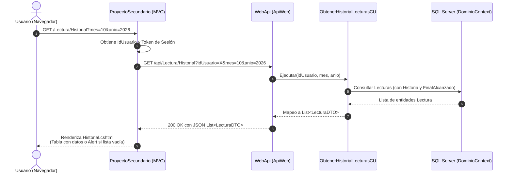

# Plan de Implementación: RF08 – Historial de lecturas – Rol Usuario

## 1. Descripción del Requerimiento
> **RF08 – Historial de lecturas – Rol Usuario**:
> Se mostrará un listado de las lecturas del usuario logueado, realizadas en un mes y año dados, indicando la historia, si fue completada y, en ese caso, el final alcanzado. Si no existen lecturas que mostrar, deberá informarlo mediante un mensaje descriptivo.

---

## 2. Arquitectura y Responsabilidades por Capa

El flujo de este requerimiento abarca tanto el backend (`Dominio` → `LogicaAccesoDatos` → `LogicaAplicacion` → `WebApi`) como el cliente MVC (`ProyectoSecundario`):



---

## 3. Código a Implementar por Componente

### A. Capa de Acceso a Datos (`Dominio` y `LogicaAccesoDatos`)

#### 1. Interfaz `IRepositorioLecturas` (`Dominio/InterfaceDeRepositorio/IRepositorioLecturas.cs`)
Agregar el método de consulta por usuario y período:
```csharp
namespace Dominio.InterfaceDeRepositorio
{
    public interface IRepositorioLecturas : IRepository<Lectura>
    {
        void ExisteLectura(Lectura aVerificar);
        bool TieneLecturasDeHistoria(int idHistoria);
        List<Lectura> FindAllCompletadas();
        
        // Nuevo método para RF08
        List<Lectura> FindByUsuarioYFecha(int idUsuario, int mes, int anio);
    }
}
```

#### 2. Implementación EF Core `RepositorioLecturasEF` (`LogicaAccesoDatos/RepositorioEntityFramework/Repositorios/RepositorioLecturasEF.cs`)
Filtrar por `idUsuario`, mes y año de la `FechaInicio`, incluyendo las navegaciones necesarias (`Historia` y `FinalAlcanzado`):
```csharp
public List<Lectura> FindByUsuarioYFecha(int idUsuario, int mes, int anio)
{
    return _context.Lecturas
        .Include(l => l.Historia)
        .Include(l => l.FinalAlcanzado)
        .Where(l => l.idUsuario == idUsuario &&
                    l.FechaInicio.Month == mes &&
                    l.FechaInicio.Year == anio)
        .OrderByDescending(l => l.FechaInicio)
        .ToList();
}
```

*(Opcional para tests en memoria)* En `RepositorioLecturas.cs`:
```csharp
public List<Lectura> FindByUsuarioYFecha(int idUsuario, int mes, int anio)
{
    return lecturas
        .Where(l => l.idUsuario == idUsuario &&
                    l.FechaInicio.Month == mes &&
                    l.FechaInicio.Year == anio)
        .OrderByDescending(l => l.FechaInicio)
        .ToList();
}
```

---

### B. Capa Lógica de Aplicación (`LogicaAplicacion`)

#### 1. Interfaz del Caso de Uso (`LogicaAplicacion/InterfacesDeCasoDeUso/Lecturas/IObtenerHistorialLecturas.cs`)
```csharp
using DTOs.DTOs;

namespace LogicaAplicacion.InterfacesDeCasoDeUso.Lecturas
{
    public interface IObtenerHistorialLecturas
    {
        List<LecturaDTO> Ejecutar(int idUsuario, int mes, int anio);
    }
}
```

#### 2. Implementación del Caso de Uso (`LogicaAplicacion/CasosDeUso/Lecturas/ObtenerHistorialLecturasCU.cs`)
Valida reglas de negocio del caso de uso (rango válido de mes, año e id) y transforma a DTOs:
```csharp
using Dominio.Entidades;
using Dominio.Excepciones;
using Dominio.InterfaceDeRepositorio;
using DTOs.DTOs;
using DTOs.Mappers;
using LogicaAplicacion.InterfacesDeCasoDeUso.Lecturas;

namespace LogicaAplicacion.CasosDeUso.Lecturas
{
    public class ObtenerHistorialLecturasCU : IObtenerHistorialLecturas
    {
        private readonly IRepositorioLecturas _repoLecturas;

        public ObtenerHistorialLecturasCU(IRepositorioLecturas repoLecturas)
        {
            _repoLecturas = repoLecturas;
        }

        public List<LecturaDTO> Ejecutar(int idUsuario, int mes, int anio)
        {
            if (idUsuario <= 0)
                throw new LecturaException("El identificador de usuario es inválido.");
            if (mes < 1 || mes > 12)
                throw new LecturaException("El mes debe estar comprendido entre 1 y 12.");
            if (anio < 2000 || anio > DateTime.Now.Year)
                throw new LecturaException($"El año debe ser válido (entre 2000 y {DateTime.Now.Year}).");

            List<Lectura> lecturas = _repoLecturas.FindByUsuarioYFecha(idUsuario, mes, anio);

            List<LecturaDTO> resultado = new();
            foreach (var l in lecturas)
            {
                resultado.Add(LecturaMapper.ToDTO(l));
            }
            return resultado;
        }
    }
}
```

#### 3. Registro en Contenedor DI (`WebApi/Program.cs`)
```csharp
builder.Services.AddScoped<IObtenerHistorialLecturas, ObtenerHistorialLecturasCU>();
```

---

### C. Capa WebApi (`WebApi/Controllers/LecturaController.cs`)

Exponer el endpoint REST para consultar el historial:
```csharp
// GET api/Lectura/Historial?idUsuario=1&mes=10&anio=2026
[HttpGet("Historial")]
[ProducesResponseType((int)HttpStatusCode.OK)]
[ProducesResponseType((int)HttpStatusCode.BadRequest)]
[ProducesResponseType((int)HttpStatusCode.InternalServerError)]
public ActionResult<IEnumerable<LecturaDTO>> GetHistorial(
    [FromQuery] int idUsuario,
    [FromQuery] int mes,
    [FromQuery] int anio)
{
    try
    {
        return Ok(_obtenerHistorialLecturasCu.Ejecutar(idUsuario, mes, anio));
    }
    catch (LecturaException lex)
    {
        return BadRequest(lex.Message);
    }
    catch (Exception ex)
    {
        return StatusCode(500, ex.Message);
    }
}
```

---

### D. Capa Frontend Lector (`ProyectoSecundario`)

#### 1. Acción en `ProyectoSecundario/Controllers/LecturaController.cs`
Gestiona la solicitud del usuario, aplica valores por defecto (mes y año actual si no se envían), realiza la petición HTTP con el token del usuario y envía los datos a la vista:
```csharp
// GET: /Lectura/Historial
[HttpGet]
public IActionResult Historial(int? mes, int? anio)
{
    string token = HttpContext.Session.GetString("token");
    if (string.IsNullOrEmpty(token)) return RedirectToAction("Login", "Auth");

    // Por defecto: mes y año actual
    int mesFiltro = mes ?? DateTime.Now.Month;
    int anioFiltro = anio ?? DateTime.Now.Year;

    int? idUsuario = HttpContext.Session.GetInt32("idUsuario");
    if (!idUsuario.HasValue)
    {
        ViewBag.Error = "No se pudo identificar el usuario logueado.";
        return View(new List<LecturaModel>());
    }

    string url = $"{baseUrl}/Historial?idUsuario={idUsuario.Value}&mes={mesFiltro}&anio={anioFiltro}";
    HttpResponseMessage respuesta = ClienteHttpAuxiliar.EnviarSolicitud(url, VerbosHttp.GET, token: token);

    List<LecturaModel> historial = new();
    if (respuesta.IsSuccessStatusCode)
    {
        string json = ClienteHttpAuxiliar.ObtenerBody(respuesta);
        historial = JsonConvert.DeserializeObject<List<LecturaModel>>(json) ?? new();
    }
    else
    {
        ViewBag.Error = "Ocurrió un error al cargar el historial de lecturas.";
    }

    ViewBag.MesSeleccionado = mesFiltro;
    ViewBag.AnioSeleccionado = anioFiltro;
    return View(historial);
}
```

#### 2. Vista Razor `ProyectoSecundario/Views/Lectura/Historial.cshtml`
Incluye el formulario de filtrado (mes y año), la grilla de lecturas y el mensaje descriptivo en caso de no existir resultados:
```razor
@model List<ProyectoSecundario.Models.LecturaModel>
@{
    ViewData["Title"] = "Historial de Lecturas";
    int mesActual = ViewBag.MesSeleccionado ?? DateTime.Now.Month;
    int anioActual = ViewBag.AnioSeleccionado ?? DateTime.Now.Year;

    string[] nombresMeses = {
        "Enero", "Febrero", "Marzo", "Abril", "Mayo", "Junio",
        "Julio", "Agosto", "Septiembre", "Octubre", "Noviembre", "Diciembre"
    };
}

<div class="container mt-4">
    <div class="d-flex justify-content-between align-items-center mb-3">
        <h2>📖 Mi Historial de Lecturas</h2>
        <a asp-controller="Historia" asp-action="Index" class="btn btn-outline-secondary">Volver al Catálogo</a>
    </div>

    <!-- Formulario de Filtro por Mes y Año -->
    <div class="card mb-4 shadow-sm">
        <div class="card-body">
            <form method="get" asp-action="Historial" class="row g-3 align-items-end">
                <div class="col-md-4">
                    <label class="form-label fw-bold">Mes:</label>
                    <select name="mes" class="form-select">
                        @for (int i = 1; i <= 12; i++)
                        {
                            <option value="@i" selected="@(i == mesActual ? "selected" : null)">
                                @nombresMeses[i - 1]
                            </option>
                        }
                    </select>
                </div>
                <div class="col-md-4">
                    <label class="form-label fw-bold">Año:</label>
                    <input type="number" name="anio" class="form-control" value="@anioActual" min="2000" max="@DateTime.Now.Year" required />
                </div>
                <div class="col-md-4 d-grid">
                    <button type="submit" class="btn btn-primary">🔍 Filtrar Lecturas</button>
                </div>
            </form>
        </div>
    </div>

    @if (ViewBag.Error != null)
    {
        <div class="alert alert-danger">@ViewBag.Error</div>
    }

    <!-- Resultado o Mensaje Descriptivo -->
    @if (Model == null || !Model.Any())
    {
        <div class="alert alert-info py-4 text-center shadow-sm" role="alert">
            <h5 class="alert-heading">Sin lecturas registradas</h5>
            <p class="mb-0">
                No existen lecturas registradas para el período seleccionado 
                <strong>(@nombresMeses[mesActual - 1] de @anioActual)</strong>.
            </p>
        </div>
    }
    else
    {
        <div class="table-responsive shadow-sm">
            <table class="table table-hover table-striped align-middle border">
                <thead class="table-dark">
                    <tr>
                        <th>Historia</th>
                        <th>Fecha de Inicio</th>
                        <th>Estado</th>
                        <th>Final Alcanzado</th>
                        <th>Fecha de Finalización</th>
                    </tr>
                </thead>
                <tbody>
                    @foreach (var lectura in Model)
                    {
                        bool completada = lectura.FechaFin.HasValue;
                        <tr>
                            <td class="fw-semibold">
                                @(lectura.Historia?.Titulo ?? $"Historia #{lectura.idHistoria}")
                            </td>
                            <td>@lectura.FechaInicio.ToString("dd/MM/yyyy HH:mm")</td>
                            <td>
                                @if (completada)
                                {
                                    <span class="badge bg-success">Completada</span>
                                }
                                else
                                {
                                    <span class="badge bg-warning text-dark">En curso</span>
                                }
                            </td>
                            <td>
                                @if (completada && lectura.FinalAlcanzado != null)
                                {
                                    <span class="fw-bold text-primary">🏁 @lectura.FinalAlcanzado.Titulo</span>
                                }
                                else
                                {
                                    <span class="text-muted">—</span>
                                }
                            </td>
                            <td>
                                @(completada ? lectura.FechaFin.Value.ToString("dd/MM/yyyy HH:mm") : "—")
                            </td>
                        </tr>
                    }
                </tbody>
            </table>
        </div>
    }
</div>
```

#### 3. Acceso en la Barra de Navegación (`ProyectoSecundario/Views/Shared/_Layout.cshtml`)
Agregar el enlace en el menú para usuarios logueados:
```razor
<li class="nav-item">
    <a class="nav-link text-dark" asp-area="" asp-controller="Lectura" asp-action="Historial">Mi Historial</a>
</li>
```

---

## 4. Paso a Paso de Ejecución

1. [ ] **Paso 1: Extender la capa de datos**
   - Declarar `FindByUsuarioYFecha` en `IRepositorioLecturas.cs`.
   - Implementar la consulta EF con `Include(Historia)` e `Include(FinalAlcanzado)` en `RepositorioLecturasEF.cs`.
2. [ ] **Paso 2: Implementar el Caso de Uso en `LogicaAplicacion`**
   - Crear la interfaz `IObtenerHistorialLecturas.cs`.
   - Crear la clase `ObtenerHistorialLecturasCU.cs` con validación de parámetros y mapeo a `LecturaDTO`.
   - Registrar `IObtenerHistorialLecturas` en `WebApi/Program.cs`.
3. [ ] **Paso 3: Exponer el endpoint en `WebApi`**
   - Inyectar el caso de uso en `WebApi/Controllers/LecturaController.cs`.
   - Crear la acción `GetHistorial` con ruta `[HttpGet("Historial")]`.
4. [ ] **Paso 4: Implementar controlador y sesión en `ProyectoSecundario`**
   - Asegurarse de que el `Id` del usuario se guarde en `Session` durante el login (`AuthController`).
   - Crear la acción `Historial(int? mes, int? anio)` en `LecturaController.cs`.
5. [ ] **Paso 5: Crear la vista Razor de Historial**
   - Crear `ProyectoSecundario/Views/Lectura/Historial.cshtml`.
   - Probar que el selector de mes y año mantenga los valores seleccionados.
   - Verificar que si la lista está vacía se muestre el alert informativo descriptivo.
6. [ ] **Paso 6: Enlazar la navegación**
   - Agregar el ítem "Mi Historial" en `_Layout.cshtml`.
7. [ ] **Paso 7: Pruebas y Verificación**
   - Realizar una lectura completa en el mes actual y verificar que aparezca con estado "Completada" y su final alcanzado.
   - Dejar una lectura a medias y comprobar que aparezca como "En curso" con guion en el final.
   - Filtrar por un mes/año sin lecturas y validar el mensaje descriptivo.
