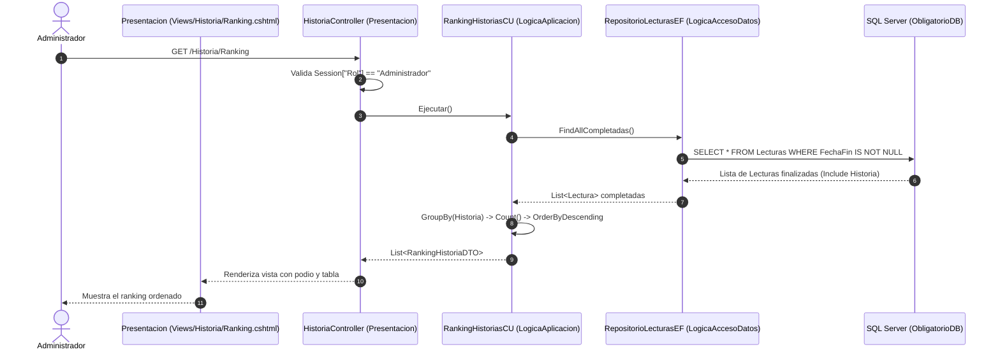

# Plan de Implementación: RF09 – Ranking de historias más leídas – Rol Administrador

## 1. Descripción del Requerimiento
> **RF09 – Ranking de historias más leídas – Rol Administrador**:
> Listado de historias ordenado por cantidad de lecturas completadas, de mayor a menor. Las historias nunca leídas no deben aparecer en el listado.

---

## 2. Análisis del Requerimiento y Reglas de Negocio

1. **Rol Requerido**: `Administrador`.
   - La pantalla vive en la aplicación backoffice [`Presentacion`](file:///C:/Users/KMIL0/Desktop/Repositorios/ProyectoObligatorio2026/ProyectoObligatorio/Presentacion/).
   - Debe verificarse que la sesión actual pertenezca a un Administrador (`Context.Session.GetString("Rol") == "Administrador"`).
2. **Criterio de ordenación**:
   - Descendente (`OrderByDescending`) por la cantidad de lecturas que hayan sido **completadas** (`FechaFin != null`).
   - Criterio de desempate: Alfabético por título (`ThenBy(r => r.Titulo)`).
3. **Filtro de exclusión**:
   - **"Las historias nunca leídas no deben aparecer en el listado"**: Al partir exclusivamente de las lecturas completadas en el repositorio (`FindAllCompletadas()`) y agrupar por historia, aquellas historias con 0 lecturas finalizadas quedan automáticamente excluidas.
4. **Presentación Visual**:
   - Podio destacado para los primeros 3 lugares (🥇 Oro, 🥈 Plata, 🥉 Bronce).
   - Tabla clara con: Posición, Título de la Historia, Cantidad de Lecturas Completadas y Enlace a Detalles.
   - Mensaje amigable si no hay lecturas completadas aún en el sistema.

---

## 3. Diagrama de Arquitectura y Flujo



---

## 4. Código a Implementar y Modificar por Capa

### A. Capa de Acceso a Datos (`LogicaAccesoDatos`)

En [`RepositorioLecturasEF.cs`](file:///C:/Users/KMIL0/Desktop/Repositorios/ProyectoObligatorio2026/ProyectoObligatorio/LogicaAccesoDatos/RepositorioEntityFramework/Repositorios/RepositorioLecturasEF.cs), el método `FindAllCompletadas()` ya está presente:
```csharp
public List<Lectura> FindAllCompletadas()
{
    return _context.Lecturas
        .Include(l => l.Historia)
        .Where(l => l.FechaFin != null)
        .ToList();
}
```

---

### B. Capa Lógica de Aplicación (`LogicaAplicacion` y `DTOs`)

#### 1. DTO Existente: `RankingHistoriaDTO.cs`
Ubicado en `DTOs/DTOs/RankingHistoriaDTO.cs`:
```csharp
namespace DTOs.DTOs
{
    public class RankingHistoriaDTO
    {
        public int IdHistoria { get; set; }
        public string Titulo { get; set; }
        public int CantLecturasCompletadas { get; set; }
    }
}
```

#### 2. Caso de Uso: `RankingHistoriasCU.cs`
En [`LogicaAplicacion/CasosDeUso/Lecturas/RankingHistoriasCU.cs`](file:///C:/Users/KMIL0/Desktop/Repositorios/ProyectoObligatorio2026/ProyectoObligatorio/LogicaAplicacion/CasosDeUso/Lecturas/RankingHistoriasCU.cs):
> **Optimización recomendada**: Agrupar por `new { Id = l.idHistoria, Titulo = l.Historia.Titulo.Valor }` en vez de por la instancia `l.Historia`, para asegurar igualdad por clave y no por referencia de memoria.

```csharp
public class RankingHistoriasCU : IRankingHistorias
{
    private readonly IRepositorioLecturas _repositorio;

    public RankingHistoriasCU(IRepositorioLecturas repositorio)
    {
        _repositorio = repositorio;
    }

    public List<RankingHistoriaDTO> Ejecutar()
    {
        List<Lectura> completadas = _repositorio.FindAllCompletadas();

        return completadas
            .Where(l => l.Historia != null)
            .GroupBy(l => new { Id = l.idHistoria ?? l.Historia.Id, Titulo = l.Historia.Titulo.Valor })
            .Select(grupo => new RankingHistoriaDTO
            {
                IdHistoria = grupo.Key.Id,
                Titulo = grupo.Key.Titulo,
                CantLecturasCompletadas = grupo.Count()
            })
            .OrderByDescending(r => r.CantLecturasCompletadas)
            .ThenBy(r => r.Titulo)
            .ToList();
    }
}
```

---

### C. Capa de Presentación Administrador (`Presentacion`)

#### 1. Registrar el Caso de Uso en DI (`Presentacion/Program.cs`)
Agregar el registro de `IRankingHistorias` que faltaba en el frontend administrativo:
```csharp
// Presentacion/Program.cs
builder.Services.AddScoped<IRankingHistorias, RankingHistoriasCU>();
```

#### 2. Acción en el Controlador (`Presentacion/Controllers/HistoriaController.cs`)
Inyectar `IRankingHistorias` y crear la acción `Ranking()`:
```csharp
public class HistoriaController : Controller
{
    // ... CUs existentes ...
    private readonly IRankingHistorias _rankingHistoriasCu;

    public HistoriaController(
        IEncontrarTodasLasHistorias encontrarTodasLasHistoriasCu,
        IObtenerHistoriaPorId obtenerHistoriaPorIdCu,
        IAgregarHistoria agregarHistoriaCu,
        IModificarHistoria modificarHistoriaCu,
        IEliminarHistoria eliminarHistoriaCu,
        IEncontrarTodasCategorias encontrarTodasCategoriasCu,
        IRankingHistorias rankingHistoriasCu) // <-- Nuevo parámetro
    {
        // ... asignaciones existentes ...
        _rankingHistoriasCu = rankingHistoriasCu;
    }

    // GET: Historia/Ranking
    [HttpGet]
    public IActionResult Ranking()
    {
        // 1. Control de acceso: Rol Administrador obligatorio
        string? rol = HttpContext.Session.GetString("Rol");
        if (rol != "Administrador")
        {
            return RedirectToAction("Login", "Usuario");
        }

        try
        {
            List<RankingHistoriaDTO> ranking = _rankingHistoriasCu.Ejecutar();
            return View(ranking);
        }
        catch (Exception ex)
        {
            ViewBag.Error = "Error al obtener el ranking: " + ex.Message;
            return View(new List<RankingHistoriaDTO>());
        }
    }
}
```

#### 3. Vista Razor Administrativa (`Presentacion/Views/Historia/Ranking.cshtml`)
```razor
@model List<DTOs.DTOs.RankingHistoriaDTO>

@{
    ViewData["Title"] = "Ranking de Historias más Leídas";
}

<div class="container mt-4">
    <div class="d-flex justify-content-between align-items-center mb-4">
        <div>
            <h2 class="fw-bold mb-1">🏆 Ranking de Historias Más Leídas</h2>
            <p class="text-muted mb-0">Historias ordenadas por cantidad de lecturas completadas con éxito.</p>
        </div>
        <a asp-action="Index" class="btn btn-outline-secondary">← Volver a Historias</a>
    </div>

    @if (ViewBag.Error != null)
    {
        <div class="alert alert-danger">@ViewBag.Error</div>
    }

    @if (Model == null || !Model.Any())
    {
        <div class="card border-0 shadow-sm p-5 text-center my-4 bg-light">
            <div class="display-6 mb-3">📚</div>
            <h4 class="text-secondary">Sin lecturas completadas</h4>
            <p class="text-muted mb-0">
                Aún no existen historias con lecturas completadas. Las historias sin lecturas no forman parte del ranking.
            </p>
        </div>
    }
    else
    {
        <div class="card shadow-sm border-0">
            <div class="table-responsive">
                <table class="table table-hover align-middle mb-0">
                    <thead class="table-dark">
                        <tr>
                            <th style="width: 120px;" class="text-center">Puesto</th>
                            <th>Título de la Historia</th>
                            <th style="width: 250px;" class="text-center">Lecturas Completadas</th>
                            <th style="width: 150px;" class="text-center">Acciones</th>
                        </tr>
                    </thead>
                    <tbody>
                        @{
                            int puesto = 1;
                        }
                        @foreach (var item in Model)
                        {
                            string badgeClass = puesto switch
                            {
                                1 => "bg-warning text-dark fs-6",
                                2 => "bg-secondary text-white fs-6",
                                3 => "bg-danger text-white fs-6",
                                _ => "bg-light text-dark border"
                            };

                            string iconoPuesto = puesto switch
                            {
                                1 => "🥇 1°",
                                2 => "🥈 2°",
                                3 => "🥉 3°",
                                _ => $"{puesto}°"
                            };

                            <tr class="@(puesto == 1 ? "table-warning fw-semibold" : "")">
                                <td class="text-center">
                                    <span class="badge @badgeClass px-3 py-2">
                                        @iconoPuesto
                                    </span>
                                </td>
                                <td>
                                    <span class="fs-5">@item.Titulo</span>
                                </td>
                                <td class="text-center">
                                    <span class="badge bg-primary fs-6 px-3 py-2">
                                        @item.CantLecturasCompletadas @(item.CantLecturasCompletadas == 1 ? "lectura" : "lecturas")
                                    </span>
                                </td>
                                <td class="text-center">
                                    <a asp-action="Details" asp-route-id="@item.IdHistoria" class="btn btn-sm btn-outline-primary">
                                        Ver Detalles
                                    </a>
                                </td>
                            </tr>
                            puesto++;
                        }
                    </tbody>
                </table>
            </div>
        </div>
    }
</div>
```

#### 4. Menú de Navegación (`Presentacion/Views/Shared/_Layout.cshtml`)
Añadir la opción visible únicamente para usuarios con rol `Administrador`:
```razor
@if (Context.Session.GetString("Rol") == "Administrador")
{
    <li class="nav-item">
        <a class="nav-link text-dark" asp-area="" asp-controller="Historia" asp-action="Index">Historias</a>
    </li>
    <li class="nav-item">
        <a class="nav-link text-dark" asp-area="" asp-controller="Historia" asp-action="Ranking">Ranking</a>
    </li>
    <li class="nav-item">
        <a class="nav-link text-dark" asp-area="" asp-controller="Auditoria" asp-action="Index">Auditoría</a>
    </li>
}
```

---

### D. Capa WebApi (`WebApi`)

El endpoint ya se encuentra configurado en [`WebApi/Controllers/LecturaController.cs`](file:///C:/Users/KMIL0/Desktop/Repositorios/ProyectoObligatorio2026/ProyectoObligatorio/WebApi/Controllers/LecturaController.cs):
- `GET /api/Lectura/Ranking` retorna `IEnumerable<RankingHistoriaDTO>` llamando a `_rankingHistoriasCu.Ejecutar()`.

---

## 5. Plan Paso a Paso de Ejecución

1. [ ] **Paso 1: Optimización del Caso de Uso**
   - Revisar [`RankingHistoriasCU.cs`](file:///C:/Users/KMIL0/Desktop/Repositorios/ProyectoObligatorio2026/ProyectoObligatorio/LogicaAplicacion/CasosDeUso/Lecturas/RankingHistoriasCU.cs) para asegurar que la agrupación (`GroupBy`) se realice por el ID y Título de la historia en lugar de la referencia del objeto.
2. [ ] **Paso 2: Registro en Inyección de Dependencias**
   - En [`Presentacion/Program.cs`](file:///C:/Users/KMIL0/Desktop/Repositorios/ProyectoObligatorio2026/ProyectoObligatorio/Presentacion/Program.cs), registrar `builder.Services.AddScoped<IRankingHistorias, RankingHistoriasCU>();`.
3. [ ] **Paso 3: Controlador en Presentación**
   - Modificar el constructor de [`HistoriaController.cs`](file:///C:/Users/KMIL0/Desktop/Repositorios/ProyectoObligatorio2026/ProyectoObligatorio/Presentacion/Controllers/HistoriaController.cs) para inyectar `IRankingHistorias`.
   - Implementar la acción `Ranking()` con validación de sesión de Administrador.
4. [ ] **Paso 4: Crear la Vista Razor**
   - Crear el archivo `Presentacion/Views/Historia/Ranking.cshtml` con diseño Bootstrap, insignias para el podio y mensaje informativo si no hay lecturas completadas.
5. [ ] **Paso 5: Enlazar en el Menú de Navegación**
   - Agregar el enlace a `Historia/Ranking` dentro del bloque `@if (Context.Session.GetString("Rol") == "Administrador")` en `_Layout.cshtml`.
6. [ ] **Paso 6: Pruebas y Validación**
   - Iniciar sesión como `Administrador`.
   - Verificar que historias con 0 lecturas o lecturas abandonadas no aparezcan en la lista.
   - Completar varias lecturas de distintas historias y comprobar que el orden descendente por cantidad sea rigurosamente respetado.
   - Probar que un usuario no autenticado o con rol distinto no pueda acceder a `/Historia/Ranking`.
