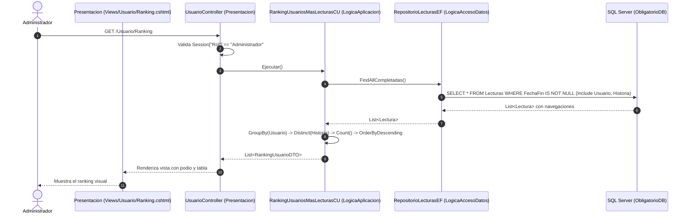

# Plan de Implementación: RF11 – Ranking de Usuarios con más Historias Leídas – Rol Administrador

## 1. Descripción del Requerimiento
> **RF11 – Usuario con más historias leídas – Rol Administrador**:
> Ranking de usuarios según la cantidad de historias distintas que completaron (leyeron hasta un final), ordenados de mayor a menor cantidad.

---

## 2. Análisis del Requerimiento y Reglas de Negocio

1. **Rol Requerido**: `Administrador`.
   - La funcionalidad es de gestión administrativa y auditoría.
   - En la aplicación MVC ([`Presentacion`](file:///C:/Users/KMIL0/Desktop/Repositorios/ProyectoObligatorio2026/ProyectoObligatorio/Presentacion/)), debe validarse que la sesión corresponda a un Administrador (`Context.Session.GetString("Rol") == "Administrador"`).
   - En [`WebApi`](file:///C:/Users/KMIL0/Desktop/Repositorios/ProyectoObligatorio2026/ProyectoObligatorio/WebApi/), el endpoint puede estar protegido o permitir consulta de reportes para el rol Administrador.

2. **Definición de "Historia Completada"**:
   - Una lectura se considera **completada** si alcanzó un desenlace: en el modelo de dominio [`Lectura`](file:///C:/Users/KMIL0/Desktop/Repositorios/ProyectoObligatorio2026/ProyectoObligatorio/ProyectoObligatorio/Entidades/Lectura.cs) esto se traduce en `FechaFin != null` y `FinalAlcanzado != null` (o `idFinal != null`).
   - Las lecturas en curso o abandonadas (`FechaFin == null`) quedan descartadas del cálculo.

3. **Criterio Clave: Historias *Distintas***:
   - **Regla crucial**: Si un usuario leyó y completó la *misma historia* 3 veces (por ejemplo, explorando finales o rutas alternativas), esa historia computa **una sola vez (1)** para ese usuario.
   - En LINQ se resuelve aplicando `.Select(l => l.idHistoria).Distinct().Count()` sobre el grupo de lecturas finalizadas de cada usuario.

4. **Criterio de Ordenación**:
   - **Principal**: De mayor a menor por cantidad de historias distintas completadas (`OrderByDescending(u => u.CantHistoriasDistintas)`).
   - **Desempate**: Alfabético por nombre de usuario (`ThenBy(u => u.NombreUsuario)`).

5. **Alcance del Ranking (Exclusión vs Inclusión de ceros)**:
   - Siguiendo el patrón de RF09 (donde historias con 0 lecturas no aparecen), el ranking parte de las lecturas finalizadas agrupadas por usuario, mostrando a todos aquellos usuarios que hayan completado al menos 1 historia. Si no hay lecturas completadas en el sistema, se muestra un mensaje informativo amigable.

---

## 3. Diagrama de Arquitectura y Flujo



---

## 4. Código a Implementar por Capa

### A. Capa de Acceso a Datos (`LogicaAccesoDatos`)

En [`RepositorioLecturasEF.cs`](file:///C:/Users/KMIL0/Desktop/Repositorios/ProyectoObligatorio2026/ProyectoObligatorio/LogicaAccesoDatos/RepositorioEntityFramework/Repositorios/RepositorioLecturasEF.cs), el método `FindAllCompletadas()` actual solo incluye `.Include(l => l.Historia)`.
Para calcular el ranking por usuario, necesitamos que también incluya `.Include(l => l.Usuario)`.

#### Modificación en `RepositorioLecturasEF.cs`:
```csharp
public List<Lectura> FindAllCompletadas()
{
    return _context.Lecturas
        .Include(l => l.Historia)
        .Include(l => l.Usuario) // <-- Necesario para obtener los datos del usuario lector
        .Where(l => l.FechaFin != null)
        .ToList();
}
```

> [!NOTE]
> En [`RepositorioLecturas.cs`](file:///C:/Users/KMIL0/Desktop/Repositorios/ProyectoObligatorio2026/ProyectoObligatorio/LogicaAccesoDatos/RepositorioEnMemoria/RepositorioLecturas.cs) (repositorio en memoria), `item.Usuario` ya vive en memoria dentro del objeto `Lectura`, por lo que no requiere cambios adicionales.

---

### B. Capa de DTOs (`DTOs`)

Crear un DTO específico para transportar los datos del ranking sin acoplar la capa de presentación a las entidades del dominio ni a los Value Objects.

#### Archivo: `DTOs/DTOs/RankingUsuarioDTO.cs`
```csharp
namespace DTOs.DTOs
{
    public class RankingUsuarioDTO
    {
        public int IdUsuario { get; set; }
        public string NombreUsuario { get; set; } = string.Empty;
        public string NombreCompleto { get; set; } = string.Empty;
        public string Email { get; set; } = string.Empty;
        public int CantHistoriasDistintas { get; set; }
    }
}
```

---

### C. Capa de Lógica de Aplicación (`LogicaAplicacion`)

#### 1. Interfaz de Caso de Uso
Crear el contrato en `LogicaAplicacion/InterfacesDeCasoDeUso/Usuarios/IRankingUsuariosMasLecturas.cs`:

```csharp
using DTOs.DTOs;

namespace LogicaAplicacion.InterfacesDeCasoDeUso.Usuarios
{
    public interface IRankingUsuariosMasLecturas
    {
        List<RankingUsuarioDTO> Ejecutar();
    }
}
```

#### 2. Implementación del Caso de Uso
Crear el archivo `LogicaAplicacion/CasosDeUso/Usuarios/RankingUsuariosMasLecturasCU.cs`:

```csharp
using Dominio.Entidades;
using Dominio.InterfaceDeRepositorio;
using DTOs.DTOs;
using LogicaAplicacion.InterfacesDeCasoDeUso.Usuarios;

namespace LogicaAplicacion.CasosDeUso.Usuarios
{
    public class RankingUsuariosMasLecturasCU : IRankingUsuariosMasLecturas
    {
        private readonly IRepositorioLecturas _repositorioLecturas;

        public RankingUsuariosMasLecturasCU(IRepositorioLecturas repositorioLecturas)
        {
            _repositorioLecturas = repositorioLecturas;
        }

        public List<RankingUsuarioDTO> Ejecutar()
        {
            // 1. Obtener todas las lecturas completadas (FechaFin != null) con Usuario e Historia
            List<Lectura> completadas = _repositorioLecturas.FindAllCompletadas();

            // 2. Agrupar por usuario, proyectar y contar historias DISTINTAS completadas
            return completadas
                .Where(l => l.Usuario != null && (l.idHistoria != null || l.Historia != null))
                .GroupBy(l => new
                {
                    Id = l.idUsuario ?? l.Usuario.Id,
                    NombreUsuario = l.Usuario.NombreUsuario,
                    NombreCompleto = $"{l.Usuario.NombreCompleto.Nombre} {l.Usuario.NombreCompleto.Apellido}",
                    Email = l.Usuario.Email.Valor
                })
                .Select(grupo => new RankingUsuarioDTO
                {
                    IdUsuario = grupo.Key.Id,
                    NombreUsuario = grupo.Key.NombreUsuario,
                    NombreCompleto = grupo.Key.NombreCompleto,
                    Email = grupo.Key.Email,
                    // Regla de Negocio: Cantidad de historias DISTINTAS completadas
                    CantHistoriasDistintas = grupo
                        .Select(l => l.idHistoria ?? l.Historia.Id)
                        .Distinct()
                        .Count()
                })
                .OrderByDescending(r => r.CantHistoriasDistintas)
                .ThenBy(r => r.NombreUsuario)
                .ToList();
        }
    }
}
```

---

### D. Capa de Presentación MVC (`Presentacion`)

#### 1. Registro en el Contenedor de Inyección de Dependencias
En [`Presentacion/Program.cs`](file:///C:/Users/KMIL0/Desktop/Repositorios/ProyectoObligatorio2026/ProyectoObligatorio/Presentacion/Program.cs):

```csharp
builder.Services.AddScoped<IRankingUsuariosMasLecturas, RankingUsuariosMasLecturasCU>();
```

#### 2. Controlador: [`UsuarioController.cs`](file:///C:/Users/KMIL0/Desktop/Repositorios/ProyectoObligatorio2026/ProyectoObligatorio/Presentacion/Controllers/UsuarioController.cs)
Inyectar `IRankingUsuariosMasLecturas` en el constructor y agregar la acción `Ranking`:

```csharp
public class UsuarioController : Controller
{
    private readonly IEncontrarTodosUsuarios encontrarTodosUsuarios;
    private readonly IAgregarUsuario agregarUsuario;
    private readonly IObtenerUsuarioPorId obtenerUsuarioPorId;
    private readonly ILoginCU loginCU;
    private readonly IRankingUsuariosMasLecturas rankingUsuariosMasLecturas; // <-- Nuevo

    public UsuarioController(
        IAgregarUsuario agregarUsuarioCu,
        IObtenerUsuarioPorId obtenerUsuarioPorIdCu,
        IEncontrarTodosUsuarios encontrarTodosUsuariosCu,
        ILoginCU loginCUCu,
        IRankingUsuariosMasLecturas rankingUsuariosMasLecturasCu) // <-- Inyección
    {
        agregarUsuario = agregarUsuarioCu;
        obtenerUsuarioPorId = obtenerUsuarioPorIdCu;
        encontrarTodosUsuarios = encontrarTodosUsuariosCu;
        loginCU = loginCUCu;
        rankingUsuariosMasLecturas = rankingUsuariosMasLecturasCu;
    }

    // GET: Usuario/Ranking
    [HttpGet]
    public IActionResult Ranking()
    {
        // 1. Control de seguridad y autorización por rol
        string? rol = HttpContext.Session.GetString("Rol");
        if (rol != "Administrador")
        {
            return RedirectToAction("Login", "Usuario");
        }

        try
        {
            List<RankingUsuarioDTO> ranking = rankingUsuariosMasLecturas.Ejecutar();
            return View(ranking);
        }
        catch (Exception ex)
        {
            ViewBag.Error = "Error al calcular el ranking de usuarios: " + ex.Message;
            return View(new List<RankingUsuarioDTO>());
        }
    }
}
```

#### 3. Vista Razor: `Presentacion/Views/Usuario/Ranking.cshtml`
```razor
@model List<DTOs.DTOs.RankingUsuarioDTO>

@{
    ViewData["Title"] = "Ranking de Usuarios con más Historias Leídas";
}

<div class="container mt-4">
    <div class="d-flex justify-content-between align-items-center mb-4">
        <div>
            <h2 class="fw-bold mb-1">👥 Ranking de Usuarios - Historias Completadas</h2>
            <p class="text-muted mb-0">Usuarios ordenados según la cantidad de historias distintas completadas con éxito.</p>
        </div>
        <a asp-controller="Usuario" asp-action="Index" class="btn btn-outline-secondary">← Volver</a>
    </div>

    @if (ViewBag.Error != null)
    {
        <div class="alert alert-danger shadow-sm">@ViewBag.Error</div>
    }

    @if (Model == null || !Model.Any())
    {
        <div class="card border-0 shadow-sm p-5 text-center my-4 bg-light">
            <div class="display-6 mb-3">📖</div>
            <h4 class="text-secondary">Sin historias completadas</h4>
            <p class="text-muted mb-0">
                Aún ningún usuario ha completado lecturas hasta un capítulo final en el sistema.
            </p>
        </div>
    }
    else
    {
        <div class="card shadow-sm border-0">
            <div class="table-responsive">
                <table class="table table-hover align-middle mb-0">
                    <thead class="table-dark">
                        <tr>
                            <th style="width: 120px;" class="text-center">Posición</th>
                            <th>Usuario</th>
                            <th>Nombre Completo</th>
                            <th>Email</th>
                            <th style="width: 260px;" class="text-center">Historias Distintas Leídas</th>
                        </tr>
                    </thead>
                    <tbody>
                        @{
                            int puesto = 1;
                        }
                        @foreach (var item in Model)
                        {
                            string badgeClass = puesto switch
                            {
                                1 => "bg-warning text-dark fs-6 shadow-sm",
                                2 => "bg-secondary text-white fs-6",
                                3 => "bg-danger text-white fs-6",
                                _ => "bg-light text-dark border"
                            };

                            string iconoPuesto = puesto switch
                            {
                                1 => "🥇 1°",
                                2 => "🥈 2°",
                                3 => "🥉 3°",
                                _ => $"{puesto}°"
                            };

                            <tr class="@(puesto == 1 ? "table-warning fw-semibold" : "")">
                                <td class="text-center">
                                    <span class="badge @badgeClass px-3 py-2">
                                        @iconoPuesto
                                    </span>
                                </td>
                                <td>
                                    <span class="fw-bold">@@@item.NombreUsuario</span>
                                </td>
                                <td>@item.NombreCompleto</td>
                                <td>
                                    <span class="text-muted">@item.Email</span>
                                </td>
                                <td class="text-center">
                                    <span class="badge bg-success fs-6 px-3 py-2">
                                        @item.CantHistoriasDistintas @(item.CantHistoriasDistintas == 1 ? "historia" : "historias")
                                    </span>
                                </td>
                            </tr>
                            puesto++;
                        }
                    </tbody>
                </table>
            </div>
        </div>
    }
</div>
```

#### 4. Menú de Navegación ([`Presentacion/Views/Shared/_Layout.cshtml`](file:///C:/Users/KMIL0/Desktop/Repositorios/ProyectoObligatorio2026/ProyectoObligatorio/Presentacion/Views/Shared/_Layout.cshtml))
Dentro de la sección de opciones para el rol `Administrador`:
```razor
@if (Context.Session.GetString("Rol") == "Administrador")
{
    <li class="nav-item">
        <a class="nav-link text-dark" asp-area="" asp-controller="Historia" asp-action="Index">Historias</a>
    </li>
    <li class="nav-item">
        <a class="nav-link text-dark" asp-area="" asp-controller="Historia" asp-action="Ranking">Ranking Historias</a>
    </li>
    <li class="nav-item">
        <a class="nav-link text-dark" asp-area="" asp-controller="Usuario" asp-action="Ranking">Ranking Usuarios</a>
    </li>
    <li class="nav-item">
        <a class="nav-link text-dark" asp-area="" asp-controller="Auditoria" asp-action="Index">Auditoría</a>
    </li>
}
```

---

### E. Capa WebApi (`WebApi`)

Para mantener la simetría entre los dos frontends del sistema (`Presentacion` y `WebApi`):

#### 1. Inyección de Dependencias ([`WebApi/Program.cs`](file:///C:/Users/KMIL0/Desktop/Repositorios/ProyectoObligatorio2026/ProyectoObligatorio/WebApi/Program.cs))
```csharp
builder.Services.AddScoped<IRankingUsuariosMasLecturas, RankingUsuariosMasLecturasCU>();
```

#### 2. Endpoint en [`WebApi/Controllers/UsuarioController.cs`](file:///C:/Users/KMIL0/Desktop/Repositorios/ProyectoObligatorio2026/ProyectoObligatorio/WebApi/Controllers/UsuarioController.cs)
```csharp
[HttpGet("Ranking")]
[ProducesResponseType(typeof(IEnumerable<RankingUsuarioDTO>), (int)HttpStatusCode.OK)]
[ProducesResponseType((int)HttpStatusCode.InternalServerError)]
public ActionResult<IEnumerable<RankingUsuarioDTO>> GetRanking()
{
    try
    {
        return Ok(_rankingUsuariosMasLecturasCu.Ejecutar());
    }
    catch (Exception ex)
    {
        return StatusCode(500, ex.Message);
    }
}
```

---

## 5. Plan Paso a Paso de Ejecución

1. **Paso 1: Actualizar Acceso a Datos (`LogicaAccesoDatos`)**
   - Modificar `FindAllCompletadas()` en `RepositorioLecturasEF.cs` agregando `.Include(l => l.Usuario)` para que las entidades `Lectura` incluyan la navegación al usuario lector.

2. **Paso 2: Crear el DTO (`DTOs`)**
   - Crear el archivo `RankingUsuarioDTO.cs` en el proyecto `DTOs/DTOs/` con los campos: `IdUsuario`, `NombreUsuario`, `NombreCompleto`, `Email` y `CantHistoriasDistintas`.

3. **Paso 3: Crear la Interfaz y Caso de Uso (`LogicaAplicacion`)**
   - Crear la interfaz `IRankingUsuariosMasLecturas.cs` en `LogicaAplicacion/InterfacesDeCasoDeUso/Usuarios/`.
   - Implementar `RankingUsuariosMasLecturasCU.cs` en `LogicaAplicacion/CasosDeUso/Usuarios/`, aplicando agrupación por usuario y cálculo con `.Distinct().Count()` sobre los IDs de historias.

4. **Paso 4: Registrar en Contenedores de DI**
   - Registrar `IRankingUsuariosMasLecturas -> RankingUsuariosMasLecturasCU` en `Presentacion/Program.cs`.
   - Registrar `IRankingUsuariosMasLecturas -> RankingUsuariosMasLecturasCU` en `WebApi/Program.cs`.

5. **Paso 5: Implementar Controlador y Vista en Presentación (`Presentacion`)**
   - Inyectar el nuevo CU en `UsuarioController.cs` e implementar la acción GET `Ranking()`, asegurando la verificación de rol `Administrador`.
   - Crear la vista Razor `Views/Usuario/Ranking.cshtml` con podio visual y tabla de posiciones.
   - Agregar el enlace "Ranking Usuarios" en `Views/Shared/_Layout.cshtml` dentro del bloque de rol `Administrador`.

6. **Paso 6: Exponer Endpoint en API REST (`WebApi`)**
   - Inyectar el CU en `WebApi/Controllers/UsuarioController.cs` y agregar el endpoint `GET /api/Usuario/Ranking`.

7. **Paso 7: Compilación y Pruebas**
   - Ejecutar `dotnet build ProyectoObligatorio.slnx` para asegurar 0 errores de compilación.
   - Probar escenarios funcionales:
     - Un usuario que completa 2 lecturas de la *misma historia*: debe contar como **1 historia distinta**.
     - Un usuario que completa lecturas de 3 historias diferentes: debe tener **3 historias**.
     - Una lectura que no llegó a un final (`FechaFin == null`): no debe computar.
     - Verificar que el orden sea estrictamente descendente por la cantidad de historias distintas leídas.
     - Comprobar que un usuario no autenticado o con rol distinto a `Administrador` sea redirigido al Login.
