# Diagrama de casos de uso del sistema

El siguiente diagrama integra `ProyectoObligatorio` y `ProyectoSecundario`.

```mermaid
flowchart LR
	visitante["Visitante"]
	usuario["Usuario lector"]
	admin["Administrador"]
	bd[("Base de datos")]
	apiActor["API Web de ProyectoObligatorio"]

	subgraph obligatorio["ProyectoObligatorio"]
		subgraph presentacion["Presentación web administrativa"]
			loginAdmin(["Iniciar sesión como administrador"])
			logoutAdmin(["Cerrar sesión"])
			registrarUsuario(["Registrar usuario"])
			consultarUsuarios(["Consultar usuarios"])
			consultarUsuario(["Consultar usuario por identificador"])
			listarHistoriasAdmin(["Listar historias"])
			crearHistoria(["Crear historia"])
			consultarHistoria(["Consultar historia"])
			modificarHistoria(["Modificar historia"])
			eliminarHistoria(["Eliminar historia"])
			crearCapitulo(["Crear capítulo"])
			consultarCategoriasAdmin(["Consultar categorías"])
			consultarAuditorias(["Consultar auditorías"])
			consultarRankingHistorias(["Consultar ranking de historias"])
			consultarRankingUsuarios(["Consultar ranking de usuarios"])
			consultarFinales(["Consultar finales de una historia"])
		end

		subgraph webapi["API Web"]
			apiLogin(["Autenticar usuario y emitir token JWT"])
			apiUsuarios(["Consultar usuarios"])
			apiUsuario(["Consultar usuario por identificador"])
			apiCategorias(["Consultar categorías"])
			apiHistorias(["Consultar todas las historias"])
			apiCatalogo(["Consultar catálogo de historias publicadas"])
			apiHistoria(["Consultar historia por identificador"])
			apiFinales(["Consultar finales de una historia"])
			apiLecturasAdmin(["Consultar todas las lecturas"])
			apiLectura(["Consultar lectura por identificador"])
			apiIniciarLectura(["Iniciar lectura"])
			apiHistorial(["Consultar historial de lecturas"])
			apiPaso(["Consultar capítulo actual"])
			apiAvanzar(["Avanzar en la lectura"])
			apiRankingHistorias(["Consultar ranking de historias"])
			apiRankingUsuarios(["Consultar ranking de usuarios"])
		end
	end

	subgraph secundario["ProyectoSecundario"]
		loginUsuario(["Iniciar sesión"])
		logoutUsuario(["Cerrar sesión"])
		cambiarEstilo(["Cambiar estilo visual"])
		verCatalogo(["Consultar catálogo de historias"])
		filtrarCategoria(["Filtrar historias por categoría"])
		comenzarLectura(["Comenzar lectura"])
		leerCapitulo(["Leer capítulo actual"])
		elegirOpcion(["Elegir opción de lectura"])
		consultarHistorial(["Consultar historial personal"])
		verRankingHistorias(["Consultar ranking de historias"])
		verRankingUsuarios(["Consultar ranking de usuarios"])
		verFinales(["Consultar finales de una historia"])
	end

	visitante --> loginAdmin
	visitante --> loginUsuario
	visitante --> registrarUsuario

	admin --> loginAdmin
	admin --> logoutAdmin
	admin --> registrarUsuario
	admin --> consultarUsuarios
	admin --> consultarUsuario
	admin --> listarHistoriasAdmin
	admin --> crearHistoria
	admin --> consultarHistoria
	admin --> modificarHistoria
	admin --> eliminarHistoria
	admin --> crearCapitulo
	admin --> consultarCategoriasAdmin
	admin --> consultarAuditorias
	admin --> consultarRankingHistorias
	admin --> consultarRankingUsuarios
	admin --> consultarFinales

	usuario --> loginUsuario
	usuario --> logoutUsuario
	usuario --> cambiarEstilo
	usuario --> verCatalogo
	usuario --> filtrarCategoria
	usuario --> comenzarLectura
	usuario --> leerCapitulo
	usuario --> elegirOpcion
	usuario --> consultarHistorial

	loginAdmin -.-> apiLogin
	loginUsuario -.-> apiLogin

	registrarUsuario -.-> apiUsuarios
	consultarUsuarios -.-> apiUsuarios
	consultarUsuario -.-> apiUsuario
	consultarCategoriasAdmin -.-> apiCategorias
	listarHistoriasAdmin -.-> apiHistorias
	crearHistoria -.-> apiHistorias
	consultarHistoria -.-> apiHistoria
	modificarHistoria -.-> apiHistorias
	eliminarHistoria -.-> apiHistorias
	crearCapitulo -.-> apiHistorias
	consultarFinales -.-> apiFinales
	consultarRankingHistorias -.-> apiRankingHistorias
	consultarRankingUsuarios -.-> apiRankingUsuarios
	consultarAuditorias -.-> apiLecturasAdmin

	verCatalogo -.-> apiCatalogo
	filtrarCategoria -.-> apiCategorias
	filtrarCategoria -.-> apiCatalogo
	comenzarLectura -.-> apiIniciarLectura
	leerCapitulo -.-> apiPaso
	elegirOpcion -.-> apiAvanzar
	consultarHistorial -.-> apiHistorial
	verRankingHistorias -.-> apiRankingHistorias
	verRankingUsuarios -.-> apiRankingUsuarios
	verFinales -.-> apiFinales

	apiActor --> apiLogin
	apiActor --> apiCategorias
	apiActor --> apiCatalogo
	apiActor --> apiHistoria
	apiActor --> apiFinales
	apiActor --> apiIniciarLectura
	apiActor --> apiHistorial
	apiActor --> apiPaso
	apiActor --> apiAvanzar
	apiActor --> apiRankingHistorias
	apiActor --> apiRankingUsuarios

	apiLogin --> bd
	apiUsuarios --> bd
	apiUsuario --> bd
	apiCategorias --> bd
	apiHistorias --> bd
	apiCatalogo --> bd
	apiHistoria --> bd
	apiFinales --> bd
	apiLecturasAdmin --> bd
	apiLectura --> bd
	apiIniciarLectura --> bd
	apiHistorial --> bd
	apiPaso --> bd
	apiAvanzar --> bd
	apiRankingHistorias --> bd
	apiRankingUsuarios --> bd
```

## Observaciones

- El administrador utiliza principalmente la interfaz web de `ProyectoObligatorio`.
- El usuario lector utiliza `ProyectoSecundario` para consultar historias y realizar lecturas.
- `ProyectoSecundario` consume la API HTTP de `ProyectoObligatorio`.
- La API utiliza autenticación JWT y autorización por rol.
- La API utiliza la base de datos `ObligatorioDB`.
- El inicio de una lectura, la consulta del capítulo actual y el avance de lectura forman el flujo principal de lectura.
- Las acciones de modificar y eliminar usuario aparecen como rutas en la interfaz administrativa, pero actualmente no tienen un caso de uso de aplicación conectado en el backend.
